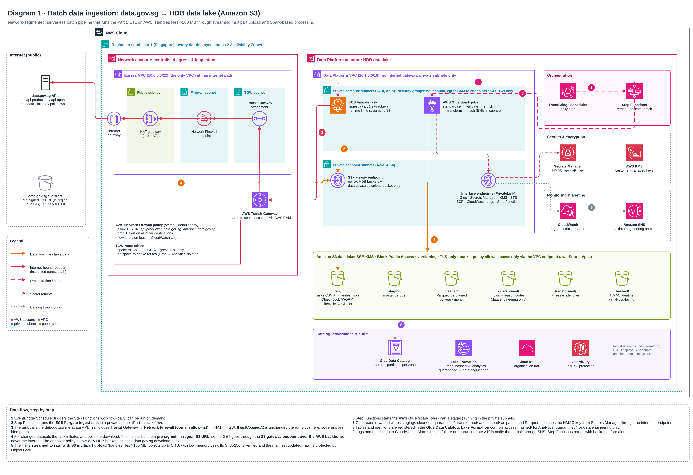
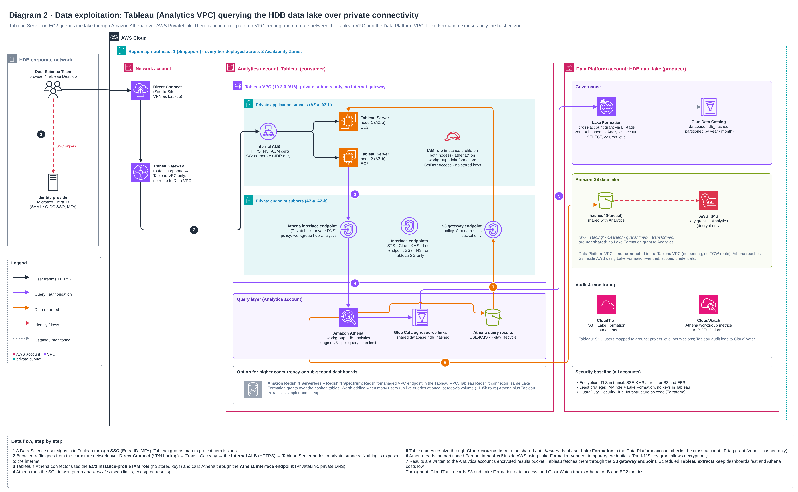

# Part 2: Data Ingestion and Data Exploitation Architecture (AWS)

Two diagrams, drawn with the official AWS architecture icons in draw.io. Each is provided as an editable `.drawio` file and an exported `.png`:

| Diagram | PNG | Editable source |
|---|---|---|
| 1. Batch ingestion: data.gov.sg → S3 data lake | [`architecture/01_batch_ingestion.png`](architecture/01_batch_ingestion.png) | [`01_batch_ingestion.drawio`](architecture/01_batch_ingestion.drawio) |
| 2. Data exploitation: Tableau → data lake | [`architecture/02_data_exploitation.png`](architecture/02_data_exploitation.png) | [`02_data_exploitation.drawio`](architecture/02_data_exploitation.drawio) |

The numbered badges in each diagram match the numbered steps below.

---

## Assumptions

| # | Assumption |
|---|---|
| A1 | A single region, **ap-southeast-1 (Singapore)**. Every tier is deployed across **2 Availability Zones**. |
| A2 | **Separate AWS accounts** under AWS Organizations: **Network** (shared egress and Transit Gateway), **Data Platform** (data lake, producer) and **Analytics** (Tableau, consumer). Account boundaries are the strongest form of segmentation and separate who can change what. |
| A3 | **Tableau Server runs self-managed on EC2** in its own private VPC, because the brief says "Tableau on AWS … resides in another private VPC". Tableau Cloud would need a different pattern (Tableau Bridge or Private Connect). |
| A4 | Users reach AWS from the HDB corporate network over **Direct Connect**, with a Site-to-Site VPN as backup. Identity comes from the corporate IdP (assumed Microsoft Entra ID) using SAML/OIDC SSO. |
| A5 | The code that runs is the **Part 1 pipeline**. Its stages map to AWS services, and its output groups map to S3 zones (raw, staging, cleaned, quarantined, transformed, hashed). |
| A6 | data.gov.sg serves files through **pre-signed URLs on in-region S3** (`s3.ap-southeast-1.amazonaws.com`, seen during the Part 1 runs). If that changes, the file host is added to the Network Firewall allow-list instead (see §1.3). |
| A7 | Batch frequency is **daily**. The data changes monthly, so daily is enough. Each run is cheap when nothing has changed because of the `lastUpdatedAt` check. |

---

## 1. Batch data ingestion (Diagram 1)

### 1.1 Flow

| Step | What happens |
|---|---|
| 1 | **EventBridge Scheduler** starts the **Step Functions** workflow every day. It can also be started on demand. |
| 2 | Step Functions runs the **ECS Fargate "ingest" task** (Part 1 `extract.py`, packaged as a container image in ECR) in a private subnet. |
| 3 | The task calls the data.gov.sg metadata API. Traffic goes **Transit Gateway → Network Firewall (domain allow-list) → NAT gateway → internet gateway** in the Network account's Egress VPC. If `lastUpdatedAt` hasn't changed, the workflow stops here, so reruns are idempotent. |
| 4 | For datasets that have changed, the task calls `initiate-download` / `poll-download` and gets a pre-signed URL. The file is on **in-region S3**, so the GET goes **through the S3 gateway endpoint over the AWS network** and never crosses the internet. The endpoint policy allows only HDB's buckets plus that one data.gov.sg download bucket. |
| 5 | The file is **streamed into `raw/` with S3 multipart upload** in chunks of about 100 MB, so files of any size up to 5 TB use little memory. The SHA-256 is checked against the manifest. `raw/` has versioning and **Object Lock** (write once, read many), so "as-is" is enforced by the platform. |
| 6 | Step Functions starts the **AWS Glue (Spark) jobs**: standardise → validate → enrich → transform → hash. They run in the private subnets through a Glue connection. |
| 7 | Glue reads `raw/` and writes `staging/`, `cleaned/`, `quarantined/`, `transformed/` and `hashed/` as **Parquet partitioned by year/month**. The HMAC key is read from **Secrets Manager** through an interface endpoint. |
| 8 | Tables and partitions are registered in the **Glue Data Catalog**. **Lake Formation** controls access using LF-tags: `hashed` for Analytics, `quarantined` for data engineering only. |
| 9 | Logs and metrics go to **CloudWatch**. Alarms fire on job failure or a **quarantine rate above 10%** (this would have caught the Mar–May 2012 storey-band issue found in Part 1) and notify the on-call through **SNS**. |

### 1.2 Design choices

| Concern | Choice | Alternatives considered |
|---|---|---|
| **Files > 100 MB** | A **Fargate task** with streaming **S3 multipart upload**: no time limit, constant memory, and failed parts retried individually. | **Lambda** (15-minute limit, 10 GB temporary disk) is fine for small files but risky as files grow. **AWS DataSync / Transfer Family** don't fit a pull from a REST API with pre-signed URLs. |
| **Complex data engineering** | **AWS Glue Spark jobs**: serverless, scale with data volume, run inside the VPC, and integrate natively with the Glue Catalog and Lake Formation. The Part 1 pandas stages port to PySpark one-to-one. | **EMR Serverless** gives more tuning control at higher operating cost. **Databricks on AWS** (with PrivateLink) is a strong option where a team already uses it. |
| **Orchestration** | **Step Functions**: serverless and pay-per-transition, with built-in retry, backoff and catch, plus a visual run history. | **Amazon MWAA (Airflow)** pays off once there are many cross-dependent pipelines. |
| **Storage layout** | **One bucket per zone**, matching the Part 1 output groups, so IAM, KMS keys, lifecycle and Object Lock can be set per zone. | Prefixes in a single bucket are simpler but give coarser access control. |
| **File format** | Parquet partitioned by `year/month`. It's columnar and compressed, and Athena prunes by partition. | CSV kept only in `raw/`. |

### 1.3 Security and network segmentation

- **Only the Network account touches the internet.** The Data Platform VPC has **no internet gateway and no public subnets**. Its only path out is through Transit Gateway to the shared Egress VPC, so outbound control sits in one place.
- **AWS Network Firewall** (stateful, default deny) allows TLS SNI only for `api-production.data.gov.sg` and `api-open.data.gov.sg`, and logs flows and alerts. This blocks data exfiltration even from a compromised container.
- **Transit Gateway route tables:** spoke VPCs route `0.0.0.0/0` to the Egress VPC only. There are **no spoke-to-spoke routes**, so the Data and Analytics VPCs can't reach each other.
- **AWS service traffic stays private:** an S3 gateway endpoint plus interface endpoints for Glue, Secrets Manager, KMS, STS, ECR, CloudWatch Logs and Step Functions.
- **S3 data lake hardening:** SSE-KMS with customer-managed keys per zone; Block Public Access; a `aws:SecureTransport` deny; a bucket policy that denies requests not coming through the VPC endpoint (`aws:SourceVpce`); versioning; Object Lock on `raw/`.
- **Secrets:** the HMAC key and the optional data.gov.sg API key are in Secrets Manager with rotation and a KMS key. Nothing is in code or images.
- **Audit:** an organisation-wide CloudTrail trail (including S3 data events), GuardDuty with S3 Protection, and VPC flow logs.

### 1.4 Reliability, scalability, maintainability, performance

| Quality | How it's addressed |
|---|---|
| **Reliability** | Multi-AZ subnets and NAT gateways; Step Functions retries with exponential backoff (data.gov.sg rate-limits heavily: HTTP 429 was seen in Part 1); per-part retries in multipart upload; idempotent reruns (manifest plus `lastUpdatedAt`); S3 versioning; failures alert through SNS. |
| **Scalability** | Fargate CPU and memory are set per task; Glue workers scale with data volume (`G.1X`/`G.2X`, auto scaling); S3 has no practical size limit; adding a dataset is a config change, not new code (as in Part 1). |
| **Maintainability** | Everything as code (Terraform), with CI/CD that deploys Glue scripts and the Fargate image; one config file controls scope and rules (Part 1 `pipeline.yaml`); unit tests run in CI; the Step Functions graph documents the run order. |
| **Performance** | Streaming upload avoids staging files on disk; Spark parallelises the transforms; Parquet with partitions lets queries scan only the months they need. |

---

## 2. Data exploitation: Tableau querying the data lake (Diagram 2)

### 2.1 Flow

| Step | What happens |
|---|---|
| 1 | A Data Science user signs in to Tableau with **SSO** (Entra ID, MFA). IdP groups map to Tableau groups and project permissions. |
| 2 | Browser traffic goes corporate network → **Direct Connect** → Transit Gateway → **internal Application Load Balancer** (HTTPS, ACM certificate; security group allows the corporate CIDR only) → **Tableau Server nodes** in private subnets across 2 AZs. |
| 3 | Tableau's **Athena connector** authenticates with the **EC2 instance-profile IAM role**, so no access keys are stored in Tableau. It calls Athena through the **Athena interface endpoint** (PrivateLink, private DNS). |
| 4 | **Athena** runs the SQL in workgroup `hdb-analytics`, which enforces a per-query scan limit, encrypted results and engine v3. |
| 5 | Table names resolve through **Glue Catalog resource links** to the `hdb_hashed` database shared from the Data Platform account. **Lake Formation** checks the cross-account LF-tag grant (`zone = hashed`, SELECT only). |
| 6 | Athena reads the Parquet in **`hashed/`** inside AWS, using **temporary credentials issued by Lake Formation** and a KMS grant that allows decrypt only. |
| 7 | Results land in the Analytics account's encrypted results bucket (7-day lifecycle). Tableau fetches them through the **S3 gateway endpoint**. **Scheduled Tableau extracts** (Hyper) keep dashboards fast and Athena costs low; live connections are still possible. |

### 2.2 Keeping traffic private, and why there's no VPC peering

The Tableau VPC creates its **own Athena interface endpoint**. Athena is a regional AWS service, so Tableau never needs a network route into the Data Platform VPC: **no VPC peering, no Transit Gateway route between the two, no shared subnets.** Athena reads S3 within AWS, with access granted by Lake Formation.

- **Least privilege at every layer:**
  - endpoint security groups accept 443 from the Tableau security group only;
  - the Athena endpoint policy is limited to the `hdb-analytics` workgroup;
  - the S3 gateway endpoint policy is limited to the results bucket;
  - the IAM role can only start queries in that workgroup and request Lake Formation data access;
  - **Lake Formation exposes only `hashed/`**: `raw/`, `staging/`, `cleaned/`, `quarantined/` and `transformed/` are not shared.
- **No internet path:** the Tableau VPC has no internet gateway or NAT. User traffic arrives over Direct Connect, and service traffic uses VPC endpoints. Tableau product updates are staged through the Network account's egress under a separate, narrow allow-list (not drawn).
- **Encryption:** TLS end to end; SSE-KMS for S3 and EBS (Tableau data volumes).
- **Audit:** CloudTrail logs S3 and Lake Formation data events, Athena keeps query history, and Tableau's audit logs go to CloudWatch.

### 2.3 Query engine: Athena, with Redshift Serverless as an option

| | **Amazon Athena (chosen)** | Amazon Redshift Serverless + Spectrum (option) |
|---|---|---|
| Fit for today's data (~105k rows) | Ideal: serverless, pay per TB scanned, nothing to run | More than needed |
| Concurrency and latency | Fine for scheduled extracts and moderate live use | Better for many concurrent live users or sub-second dashboards |
| Private connectivity | Interface endpoint in the Tableau VPC | Redshift-managed VPC endpoint in the Tableau VPC |
| Governance | Lake Formation (same grants) | Lake Formation (same grants) via Spectrum |
| Tableau connector | Native Athena connector (JDBC) | Native Redshift connector |

**When to add Redshift:** when dashboards move to live queries with many users at once, or query latency becomes a complaint. The Lake Formation grants and the S3 layout stay the same, so it's an addition rather than a redesign.

### 2.4 Reliability, scalability, maintainability, performance

| Quality | How it's addressed |
|---|---|
| **Reliability** | Tableau Server runs as a multi-node cluster across 2 AZs behind the ALB; Athena is serverless across multiple AZs; Direct Connect has a VPN backup. |
| **Scalability** | Add Tableau nodes horizontally; Athena concurrency scales on demand; Redshift Serverless is the upgrade path (§2.3). |
| **Maintainability** | The same infrastructure-as-code approach; Lake Formation LF-tags mean new tables tagged `zone = hashed` are shared automatically, with no per-table grants. |
| **Performance** | Partitioned Parquet with partition pruning; Tableau extracts for heavy dashboards; workgroup scan limits stop runaway queries. |
